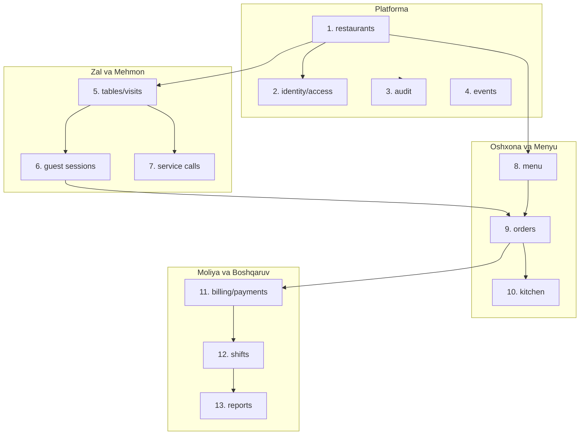
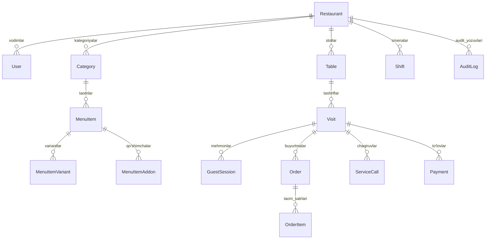

# MENUREST.UZ — Tizim Arxitekturasi va Loyihalash Hujjati (System Architecture)

Ushbu hujjat **menurest.uz** tizimining arxitektura tamoyillari, domen chegaralari, ma'lumotlar bazasi mantiqiy modeli, ko'p ijarachilik (multi-tenancy) izolyatsiyasi va texnologik stackini belgilaydi.

---

## 1. Arxitektura Turi: Modulli Monolit (Modular Monolith)

Tizim ortiqcha mikroservis tarqoqligi va tarmoq kechikishlarisiz, yuqori darajada mustaqil va qat'iy chegaralangan domen modullariga ega **Modulli Monolit** sifatida quriladi. Barcha domenlar o'zlarining xizmatlari (services), kontrollerlari va ma'lumotlar kirish qatlamiga ega bo'lib, umumiy PostgreSQL bazasidan foydalanadi.

### Texnologik Stack:
- **Backend Muhiti:** Node.js v24 LTS + TypeScript 5.x
- **API Framework:** NestJS / Fastify-Express modulli tuzilmasi, REST API, OpenAPI/Swagger
- **ORM va Migratsiyalar:** Prisma ORM va PostgreSQL (ACID tranzaksiyalari, `SELECT ... FOR UPDATE` row-level qulflari)
- **Frontend Texnologiyasi:** React 19, Vite, TypeScript, Tailwind CSS, Lucide Icons
- **Real-vaqt Aloqasi (Real-time):** Server-Sent Events (SSE) / WebSocket (avtomatik qayta ulanish va `Last-Event-ID` sinxronizatsiyasi bilan)
- **Paket Menejeri:** npm (qat'iy `package-lock.json` bilan)

---

## 2. Domenlar va Chegaralar (13 Ta Domen Moduli)



### 2.1. `identity/access` (Identifikatsiya va Ruxsatlar)
- Foydalanuvchilar (`User`), parol xesh (Argon2/Bcrypt), JWT tokenlar, sessiyalar.
- Ko'p rollilik modeli (`UserRole`: `SUPER_ADMIN`, `BOSS`, `MANAGER`, `CASHIER`, `WAITER`, `KITCHEN`).
- Super adminning tenantga kadr sifatida kirishi (Support Impersonation) va uning auditini yuritish.

### 2.2. `restaurants` (Restoran va Tenant Boshqaruvi)
- Restoran asosiy profili (`Restaurant`: nomi, slug, telefon, manzil, litsenziya holati).
- Restoran sozlamalari (`RestaurantSettings`: xizmat haqi foizi, valyuta `UZS`, ish vaqti, til sozlamalari).

### 2.3. `menu` (Menyu, Kategoriyalar va Modifikatorlar)
- Kategoriyalar (`Category`: ketma-ketlik tartibi, nomi, tavsifi).
- Taomlar (`MenuItem`: narx, rasm, stansiya turi — oshxona/bar/gril, faollik, stop-list).
- Variantlar va qo'shimchalar (`MenuItemVariant`, `MenuItemAddon`: o'lcham, ta'm, qo'shimcha narxlar).

### 2.4. `tables/visits` (Stollar va Faol Tashriflar)
- Stollar (`Table`: raqami, sig'imi, zal zonasi, statik QR token).
- Stol holatlari: `FREE`, `OCCUPIED`, `DIRTY`.
- Tashriflar (`Visit`: stoldagi faol mehmonlar davri, ochilish vaqti, yopilish vaqti, faol PIN/passcode, moliyaviy status).

### 2.5. `guest sessions` (Mehmon Sessiyasi)
- Vaqtinchalik mehmon tokeni (`GuestSession`: faol `Visit`ga bog'langan, cheklangan muddatli JWT/token).
- Bir stolda o'tirgan bir nechta mehmonlarning bir xil faol tashrifga qo'shilishi.
- Rate limiting va so'rovlar nazorati.

### 2.6. `orders` (Buyurtmalar va Taom Satrlari)
- Buyurtma agregati (`Order`: visitId, tableId, buyurtmachi, umumiy hosil qilingan holat, eslatma).
- Taom satri (`OrderItem`: menuItemId, snapshotName, snapshotPrice, variantSnapshot, addonsSnapshot, miqdor, holat, bekor qilish sababi).
- Tarixiy daxlsizlik (Snapshot) kafolati.

### 2.7. `service calls` (Ofitsiant Chaqiruvlari)
- Chaqiruvlar (`ServiceCall`: visitId, tableId, turi — `WAITER`, `BILL`, `WATER`, `CUSTOM`, holat — `PENDING`, `ACKNOWLEDGED`, `RESOLVED`).
- Ofitsiant tomonidan qabul qilish va hal qilish vaqtlari auditi.

### 2.8. `kitchen` (KDS — Oshxona va Bar Displeyi)
- Oshxona chiptalari va stansiyalari (`KitchenStation`: Oshxona, Bar, Gril, Sovuq tsex).
- Taom tayyorlash holatlari: `ACCEPTED` → `PREPARING` → `READY`.
- Tayyorlanish vaqtlarini kuzatish (tayyorlash kechikishi taymerlari).

### 2.9. `billing/payments` (Moliya va To'lovlar)
- Server-authoritative hisob-kitoblar (Subtotal, Xizmat haqi, Chegirma, Jami, To'langan, Qoldiq).
- To'lov yozuvlari (`Payment`: visitId, cashierId, usul — `CASH`, `TERMINAL`, summa, status).
- Append-only daxlsizlik: to'lovlar o'chirilmaydi, xato to'lovlar qarshi yozuv (`Reversal` / `Refund`) bilan to'g'irlanadi.
- Aralash to'lovlar (Split Payment) qo'llab-quvvatlanadi.

### 2.10. `shifts` (Kassa Smenalari)
- Smenalar (`Shift`: cashierId, ochilish vaqti, yopilish vaqti, boshlang'ich naqd qoldiq, yakuniy naqd, terminal jami, tafovut/discrepancy).
- Smena hisoboti (Z-report).

### 2.11. `reports` (Hisobotlar va Tahlil)
- Boss va Manager uchun analitika: kunlik tushum, soatlar bo'yicha yuklama, eng ko'p sotilgan taomlar, ofitsiantlar aylanmasi.
- Sana va vaqtlar qat'iy `Asia/Tashkent` vaqt zonasida hisoblanadi.

### 2.12. `audit` (Audit Loglari)
- O'zgarmas audit jurnali (`AuditLog`: id, restaurantId, actorId, actorRole, action, entityName, entityId, oldState, newState, reason, ipAddress, createdAt).
- Narx o'zgarishi, taom bekor qilinishi, chegirmani qo'llash, to'lov kiritish va super admin tashriflari qayd etiladi.

### 2.13. `events` (Hodisalar va Jonli Sinxronizatsiya)
- Ichki hodisalar shinasi (Domain Event Bus).
- Tashqi brauzerlar uchun SSE / WebSocket oqimi (stollar holati, yangi buyurtmalar, KDS chiptalari, ofitsiant chaqiruvlari).

---

## 3. Ko'p Ijarachilik (Multi-Tenancy) Xavfsizlik Modeli

- **Mantiqiy Izolyatsiya:** Barcha ma'lumotlar jadvallarida (Userdan tashqari barcha operatsion ma'lumotlarda) `restaurant_id` ustuni majburiy bo'ladi.
- **Tenant Context Injection:** Har bir kiruvchi so'rovda middleware/guard foydalanuvchi tokenidagi `restaurant_id`ni ajratib oladi va so'rov kontekstiga biriktiradi.
- **Avtomatik Filtr:** ORM qatlamida (Prisma middleware / extensions) barcha `findMany`, `findOne`, `update`, `delete` so'rovlariga joriy `restaurant_id` qat'iy qo'shiladi. Boshqa restoranning IDsi so'ralganda xavfsizlik maqsadida `404 NOT_FOUND` (yoki `403 FORBIDDEN`) qaytariladi.
- **Super Admin Istisnosi:** Super Admin tenantga faqat audit qilinadigan maxsus "Support Impersonation" sessiyasi bilan kira oladi.

---

## 4. Ma'lumotlar Bazasi Asosiy Modeli (ER Diagramma)



---

## 5. Pul Hisobi va Tranzaksion Bloklash (Concurrency)

Bir tashrif hisobida bir vaqtning o'zida bir nechta parallel operatsiyalar bajarilganda (masalan, ofitsiant yangi taom qo'shayotgan paytda kassir hisobni yopishga urinsa yoki mehmon yangi buyurtma yuborsa):

1. **Visit Row-Level Lock:**
   Barcha moliyaviy amallar va tashrif holatini o'zgartiruvchi operatsiyalar tranzaksiya boshida shu tashrif qatorini qulflaydi:
   ```sql
   SELECT * FROM visits WHERE id = $1 FOR UPDATE;
   ```
2. **Hisob-kitob Invarianti:**
   Jami summa har doim serverda formula asosida yig'iladi:
   $$\text{Subtotal} = \sum (\text{OrderItem.snapshotPrice} \times \text{quantity})$$
   $$\text{ServiceAmount} = \text{Subtotal} \times \frac{\text{ServiceChargePercent}}{100}$$
   $$\text{DiscountAmount} = \text{Subtotal} \times \frac{\text{DiscountPercent}}{100}$$
   $$\text{Total} = \text{Subtotal} + \text{ServiceAmount} - \text{DiscountAmount}$$
   $$\text{PaidTotal} = \sum (\text{Payment.amount}) - \sum (\text{Refund.amount})$$
   $$\text{Balance} = \text{Total} - \text{PaidTotal}$$
3. **Deadlock & Serialization Retry:**
   PostgreSQL `40001` (serialization failure) yoki `40P01` (deadlock detected) holatlarida tranzaksiya eksponentsial kechikish bilan avtomatik qayta uriniladi (maksimal 3 marta).
4. **Idempotency:**
   Har bir to'lov yoki buyurtma yaratish so'rovi mijozdan `Idempotency-Key` oladi. Bir xil kalitli takroriy so'rov o'tgan natijani qaytaradi, boshqa parametrlar bilan kelsa `409 CONFLICT` beradi.
