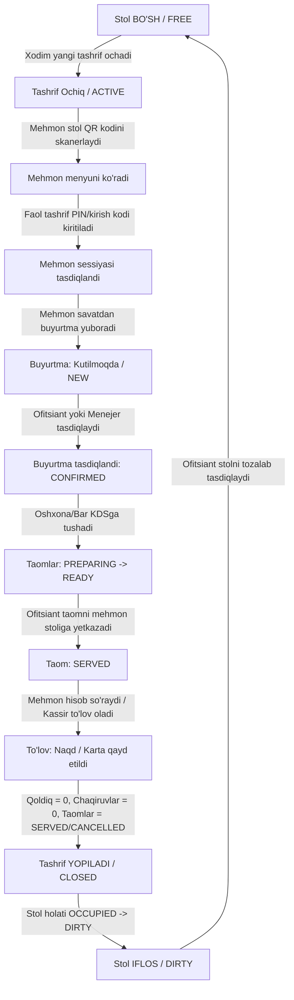

# MENUREST.UZ — Mahsulot va Tizim Spetsifikatsiyasi (Product Spec)

Ushbu hujjat **menurest.uz** platformasining asosiy biznes talablari, arxitektura tamoyillari, qat'iy biznes invariantlari va loyiha doirasini belgilaydi. Platformaning har bir moduli, API nuqtasi, frontend ekrani va ma'lumotlar bazasi jadvallari ushbu spetsifikatsiyaga to'liq bo'ysunadi.

---

## 1. Loyiha Haqida va Doira (Scope)

**menurest.uz** — umumiy ovqatlanish korxonalari (restoran, kafe, bar) uchun mo'ljallangan, ko'p ijarachili (multi-tenant) raqamli boshqaruv platformasi. Tizim mehmon QR menyusi, buyurtma berish, ofitsiant va xizmat ko'rsatish, oshxona/bar displeyi (KDS), kassa va smena hisobi, hamda boshqaruv panellarini yagona mexanizmga birlashtiradi.

### 1.1. Asosiy Doiradagi Imkoniyatlar (In Scope)
- **Mehmon Tajribasi:** Hech qanday mobil ilova o'rnatmasdan, telefon brauzeri orqali QR kod yordamida menyuni ko'rish, faol tashrifga PIN/kirish kodi orqali ulanish, savatcha yig'ish, buyurtma berish va ofitsiantni chaqirish.
- **Ko'p Restoranlilik (Multi-tenant SaaS):** Bir platforma instansiyasida bir nechta mustaqil restoranlar faoliyat yuritadi. Har bir restoranning barcha ma'lumotlari (menyu, stollar, xodimlar, buyurtmalar, moliya) qat'iy mantiqiy va xavfsizlik darajasida izolyatsiya qilinadi.
- **Xodim Rollari:**
  - `SUPER_ADMIN` — platforma egasi; restoranlarni boshqarish, global monitoring, tizim sozlamalari va tenantlarga yordam auditi.
  - `BOSS` — restoran egasi/ta'sischisi; moliyaviy hisobotlar, foyda, xodimlar, sozlamalar va to'liq audit.
  - `MANAGER` — restoran menejeri; menyu, stollar, xodimlar, smenalar, buyurtmalarni boshqarish va taom bekor qilishni tasdiqlash.
  - `CASHIER` — kassir; to'lovlarni qayd etish, cheklar, aralash to'lovlar, qaytarishlar, smenalar va tashriflarni yopish.
  - `WAITER` — ofitsiant; chaqiruvlarni qabul qilish, buyurtmalarni tasdiqlash, taom yetkazish, stol tozalash.
  - `KITCHEN` — oshpaz/barmen; KDS orqali biriktirilgan stansiyalar bo'yicha taomlarni ko'rish va tayyorlash.
- **Moslashuvchan Rollar:** Bir jismoniy xodimga bitta restoran doirasida bir nechta rol biriktirilishi mumkin (masalan, Manager + Cashier). Barcha harakatlar xodimning aniq shaxsiy akkauntiga audit qilinadi.
- **GUEST Huquqi:** GUEST bu xodim akkaunti emas; u stoldagi faol tashrifga (`Visit`) bog'langan, vaqtinchalik va cheklangan huquqli sessiyadir.
- **Kassa va To'lovlar:** Naqd pul va restoranning tashqi bank terminallarida qabul qilingan to'lovlarni qayd etish. Aralash to'lov (Split/Mixed payment) — bitta hisob bo'yicha qisman naqd, qisman karta orqali to'lov yozuvlarini qo'llab-quvvatlash.
- **Xizmat joyi:** 1-versiyada har bir restoran alohida mustaqil xizmat joyi sifatida qaraladi.

### 1.2. Hozirgi Doiradan Tashqaridagi Masalalar (Out of Scope)
- Click, Payme, Uzum va boshqa onlayn to'lov shlyuzlari integratsiyasi (keyingi bosqichlarda).
- Davlat soliq qo'mitasi / OFD fiskal chek apparatlari integratsiyasi.
- Telegram bot xabarnomalari (keyingi bosqichlarda qo'shiladi).
- Native iOS/Android ilovalar (barcha interfeyslar zamonaviy Responsive Web orqali ishlaydi).
- Yetkazib berish (Delivery), ombor qoldig'i (Inventory) va taom tannarxi hisobi (Cost of goods sold).

---

## 2. Asosiy Hayot Sikli (Core Operational Lifecycle)

---

## 3. Taom va Buyurtma Holatlari Mexanizmi

### 3.1. Taom Holatlari (OrderItem Status Lifecycle)
Har bir taom satri mustaqil holatga ega:
`PENDING` → `ACCEPTED` → `PREPARING` → `READY` → `SERVED` (yoki asosli sabab bilan `CANCELLED`).

- **PENDING:** Mehmon buyurtma berdi, ofitsiant tasdig'ini kutmoqda. Bekor qilish: Mehmon (o'z buyurtmasini hali tasdiqlanmasdan) yoki Ofitsiant qila oladi.
- **ACCEPTED:** Ofitsiant buyurtmani qabul qildi, oshxona/bar stansiyasiga yo'naltirildi. Bekor qilish: Ofitsiant sabab ko'rsatgan holda bekor qilishi mumkin.
- **PREPARING:** Oshxona/bar taomni tayyorlashni boshladi (KDS chiptasi faollashdi).
  - **Qat'iy qoida:** `PREPARING` holatiga o'tgandan so'ng taomni oddiy ofitsiant bekor qila OLMAYDI. Masalliq sarflanganligi sababli faqat **Manager** yoki **Boss** tasdig'i va majburiy sabab (`cancellation_reason`) bilan bekor qilinadi.
- **READY:** Oshxona/bar taom tayyor bo'lganini bildirdi. Ofitsiantga bildirishnoma bordi.
- **SERVED:** Ofitsiant taomni mehmon stoliga yetkazdi va topshirdi.
  - **Qat'iy qoida:** `SERVED` bo'lgan taomni oddiy bekor qilib bo'lmaydi. Agar mijoz shikoyat qilsa yoki xatolik bo'lsa, bu tizimda **Auditli moliyaviy tuzatish (Financial Adjustment / Reversal)** sifatida rasmiylashtiriladi (Manager/Boss vakolatida).
- **CANCELLED:** Taom bekor qilindi. Audit logiga sabab, xodim va vaqt yoziladi.

### 3.2. Hosil Qilinadigan Buyurtma Holati (Derived Order Status)
Buyurtma (`Order`) holati o'z ichidagi barcha taomlarning (`OrderItem`) holatlaridan hisoblanadi. Alohida sun'iy o'zgartirilmaydi.

**Ustuvorlik qoidalari va hosil qilish logikasi:**
1. Agar barcha taomlar `CANCELLED` bo'lsa → **`CANCELLED`**
2. Agar barcha faol taomlar `SERVED` bo'lsa (yoki qolganlari bekor bo'lsa) → **`SERVED`**
3. Agar kamida bitta taom `SERVED` bo'lib, qolgan faol taomlar tayyorlanayotgan yoki kutilayotgan bo'lsa → **`PARTIALLY_SERVED`**
4. Agar barcha faol taomlar `READY` bo'lsa → **`READY`**
5. Agar kamida bitta taom `READY` bo'lsa, boshqalari hali `PREPARING`/`ACCEPTED` bo'lsa → **`PARTIALLY_READY`**
6. Agar kamida bitta taom `PREPARING` bo'lsa → **`PREPARING`**
7. Agar kamida bitta taom `ACCEPTED` bo'lsa → **`CONFIRMED`**
8. Agar barcha taomlar `PENDING` bo'lsa → **`NEW`**

**Aralash holatlar bo'yicha misollar:**
- *1-misol:* Osh (PREPARING), Choy (READY). Bitta taom tayyor, biri pishmoqda → Buyurtma holati: **`PARTIALLY_READY`**.
- *2-misol:* Salat (SERVED), Qozon kabob (PREPARING). Bitta taom yetkazildi, ikkinchisi pishmoqda → Buyurtma holati: **`PARTIALLY_SERVED`**.
- *3-misol:* Sho'rva (CANCELLED), Somsa (READY). Faol taomlarning barchasi tayyor → Buyurtma holati: **`READY`**.
- *4-misol:* Choy (SERVED), Non (SERVED), Kola (CANCELLED). Barcha faol taomlar berildi → Buyurtma holati: **`SERVED`**.

---

## 4. Qat'iy Biznes Qoidalari (14 Ta Buzilmas Invariant)

1. **Stol va Tashrif Alohidaligi:**
   Stol (`Table`) — doimiy fizik obyekt. Tashrif (`Visit`) — shu stolda mehmonlarning o'tirishi uchun ochiladigan vaqtinchalik mustaqil mantiqiy davr.
2. **Yagona Faol Tashrif:**
   Bitta stolda bir vaqtning o'zida faqat bitta faol (`ACTIVE`) tashrif bo'lishi mumkin. PostgreSQL darajasida qat'iy cheklov (`UNIQUE` partial index yoki tranzaksion qulf) bilan ta'minlanadi.
3. **Stol Holatlari Davri:**
   Stol faqat uchta holatda bo'ladi: `FREE`, `OCCUPIED`, `DIRTY`.
   - Tashrif ochilganda: `FREE` → `OCCUPIED`.
   - Tashrif yopilganda: `OCCUPIED` → `DIRTY`.
   - Xodim tozalashni tasdiqlaganda: `DIRTY` → `FREE`.
4. **To'lov Tashrifni Avtomatik Yopmaydi:**
   Qoldiq summa 0 bo'lsa ham, tashrif ochiq qoladi. Chunki ochiq tashrifdagi mehmonlar yana qo'shimcha taom yoki ichimlik buyurtma qilishi mumkin (bu yangi qarz hosil qiladi).
5. **Tashrifni Yopish Shartlari:**
   Tashrifni yopish (`closeVisit`) uchun quyidagi 3 shart qat'iy bajarilgan bo'lishi shart:
   - Moliyaviy qoldiq aynan **0 UZS** bo'lishi;
   - Ochiq ofitsiant chaqiruvlari (`ServiceCall`) bo'lmasligi;
   - Barcha buyurtma qilingan taomlar mehmonga yetkazilgan (`SERVED`) yoki asosli sabab bilan bekor qilingan (`CANCELLED`) bo'lishi.
6. **QR va Avtorizatsiya Chegarasi:**
   Statik QR kod (va undagi havola/tableId) faqat restoranni va stolni aniqlashga xizmat qiladi. QR kodning o'zi buyurtma berish yoki hisobni o'zgartirish huquqini bermaydi. Buyurtma berish uchun faol tashrifga bog'langan xavfsiz mehmon tokeni/kirish kodi shart.
7. **Yopilgan Tashrif Daxlsizligi:**
   Yopilgan (`CLOSED`) tashrifga hech qachon yangi buyurtma, to'lov yoki chaqiruv yozilmaydi. Tarixiy moliyaviy xatoliklar faqat maxsus vakolatli (Boss/Manager) auditli `Correction Workflow` orqali tuzatiladi. Keyingi mijozlar yangi sessiya va yangi kirish kodi bilan boshlanadi.
8. **Server-Authoritative Narxlar:**
   Barcha narxlar, chegirmalar, xizmat haqlari (Service Charge %), soliqlari, jami summa va qoldiqlar istisnosiz **faqat serverda** hisoblanadi. Mijoz brauzeri yoki ofitsiant ilovasi yuborgan narxlar va jami summalarga mutlaqo ishonilmaydi.
9. **Buyurtma Elementlarining Tarixiy Nusxasi (Snapshot):**
   Buyurtma yaratilgan paytda taomning nomi, uning tanlangan varianti, qo'shimchalari va aynan o'sha lahzadagi narxi buyurtma satriga (`OrderItem`) to'liq nusxalanadi (snapshot). Restoran menyusida keyinchalik narx oshsa yoki taom o'chirilsa ham, o'tmishdagi buyurtmalar narxi va mazmuni o'zgarmaydi.
10. **Alohida Taom Holatlari:**
    Buyurtmadagi har bir taom o'z holatiga ega (`PENDING`, `ACCEPTED`, `PREPARING`, `READY`, `SERVED`, `CANCELLED`). Umumiy buyurtma holati ushbu taomlarning holatlaridan kelib chiqib hisoblanadi.
11. **Idempotentlik Kafolati:**
    Tarmoqdagi uzilishlar sababli takror yuborilgan so'rovlar (buyurtma, to'lov) bir operatsiyani ikki marta bajarmasligi uchun `Idempotency-Key` orqali himoyalanadi. Agar bir xil kalit bilan boshqa mazmun yuborilsa, server `409 Conflict` qaytaradi.
12. **Tranzaksion Butunlik va Parallelizm:**
    To'lov kiritish, yangi buyurtma qo'shish, chegirma berish yoki tashrifni yopish amallari parallel kelganda hisob buzilmasligi uchun barcha moliyaviy amallar va tashrif holati bitta umumiy tartibda `Visit` qatorini qulflaydi (`SELECT ... FOR UPDATE`).
13. **To'liq Audit Tarixi:**
    Narx o'zgarishi, taom bekor qilinishi, chegirmani qo'llash, to'lov kiritish kabi muhim o'zgarishlar qaysi xodim tomonidan, qachon, qaysi sababga ko'ra qilingani audit jadvaliga (`AuditLog`) yozib boriladi.
14. **Buxgalteriya Qoidasi (Append-only Financials):**
    To'lov va qaytarish yozuvlari ma'lumotlar bazasidan oddiy `DELETE` bilan o'chirilmaydi. Xato qilingan to'lovlar sababi ko'rsatilgan holda qarshi to'lov (Reversal / Refund yozuvi) orqali to'g'irlanadi.

---

## 5. Pul Hisobi va DB Bloklash Tartibi (Financial Concurrency)

Bir tashrif (`Visit`) bo'yicha pulga ta'sir qiluvchi quyidagi barcha operatsiyalar:
- Yangi buyurtma tasdiqlash (`confirmOrder`)
- Chegirma kiritish yoki o'zgartirish (`applyDiscount`)
- Xizmat haqini hisoblash (`calculateServiceCharge`)
- To'lov qayd etish (`recordPayment`)
- Qaytarish/tuzatish kiritish (`refundPayment` / `correction`)
- Tashrifni yopish (`closeVisit`)

**Qat'iy tranzaksiya tartibi:**
1. Tranzaksiya boshlanishi (`BEGIN`).
2. Doim birinchi navbatda shu tashrif qatori bloklanadi: `SELECT * FROM visits WHERE id = :visit_id FOR UPDATE`.
3. Tashrif holati tekshiriladi: agar `status != 'ACTIVE'` bo'lsa, tranzaksiya bekor qilinadi va `409 STATE_CONFLICT` qaytariladi.
4. Joriy hisob-kitoblar (jami buyurtmalar, chegirmalar, olingan to'lovlar va qoldiq) qayta hisoblanadi.
5. Yangi moliyaviy yozuv (Payment / Adjustment) yoziladi yoki tashrif holati o'zgartiriladi.
6. Audit logiga qayd etiladi.
7. Tranzaksiya tasdiqlanadi (`COMMIT`).

**Deadlock va Serialization Retry siyosati:**
- Deadlock yoki PostgreSQL `40P01` / `40001` (serialization failure) holatlarida tizim avtomatik cheklangan qayta urinish (retry) mexanizmiga ega:
  - Maksimal urinishlar: 3 marta.
  - Kutish oralig'i: eksponentsial jitter (50ms, 150ms, 300ms + random jitter).
  - Agar 3-urinishdan keyin ham muvaffaqiyatsiz bo'lsa, xavfsiz `409 STATE_CONFLICT` qaytariladi.
